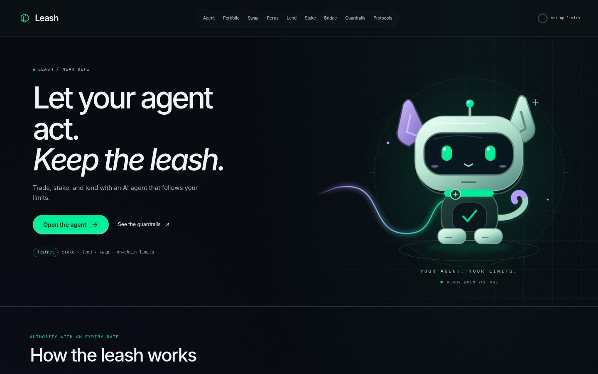
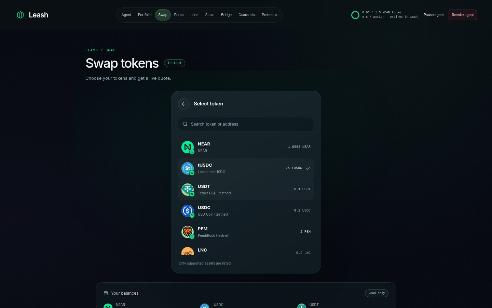
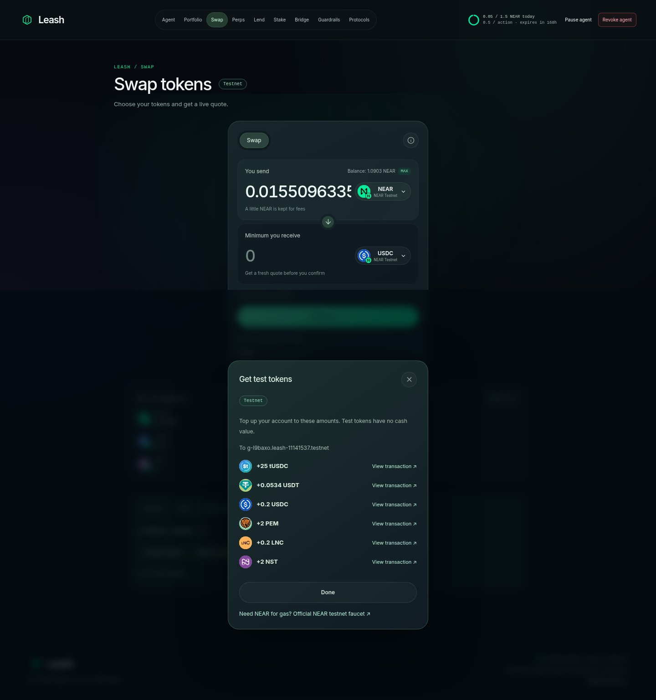
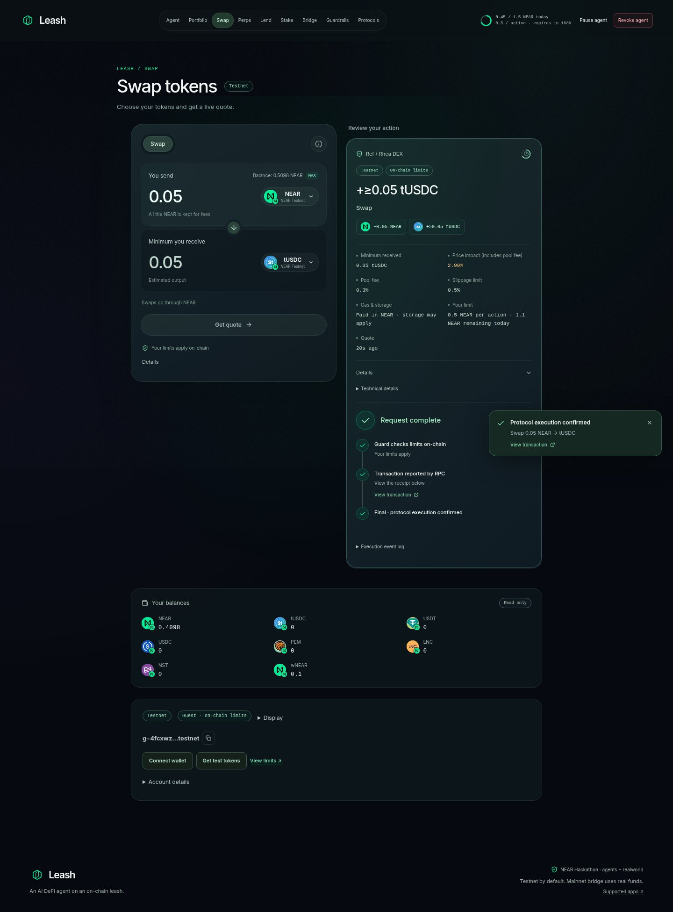
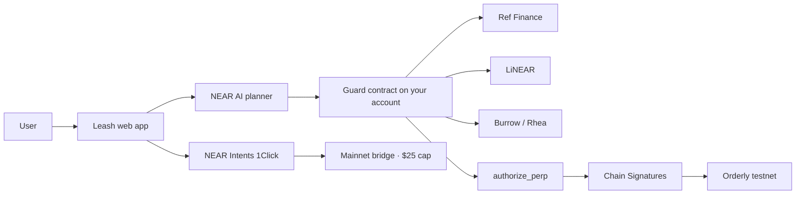

# Leash

**An AI DeFi agent on an on-chain leash.**

Live: [https://leash.leash-agent.workers.dev](https://leash.leash-agent.workers.dev)

Leash is an AI agent that can swap, stake, lend, and open perps for you on NEAR testnet. Its limits are enforced by a smart contract on your own account, not by a prompt. The agent holds a function-call key that can only call the guard on your account. The guard checks every action against your policy, and revoke deletes the key on-chain.

Built for the NEAR Hackathon (tracks: **agents** and **realworld**).

## Features

- **On-chain guard** — a NEAR Global Contract installed on your account. It enforces per-action and daily caps, a protocol allow-list, slippage and leverage caps, an expiry, plus pause, resume, and revoke.
- **Swap** — seven tokens on Ref Finance testnet: NEAR, tUSDC, USDT, USDC, PEM, LNC, and NST, each with a logo.
- **Stake** — LiNEAR stake and unstake at the live exchange rate.
- **Lend** — supply and withdraw wNEAR on Burrow / Rhea Lending. Borrowing is off because the testnet oracle does not price wNEAR.
- **Perps** — Orderly EVM testnet, with the account owned via NEAR Chain Signatures. Every order is first authorised on-chain by the guard.
- **Bridge** — NEAR Intents 1Click quotes on **mainnet**, capped at **$25** including fees. Your own wallet signs; the server never holds mainnet keys. Guest mode cannot bridge.
- **Faucet** — testnet tokens for guest accounts and connected wallets.
- **AI planner** — NEAR AI Cloud with tool calling over a strict action schema, then deterministic rules as fallback.

Guest mode is autonomous on testnet. Wallet-connect mode is a co-pilot: the agent proposes, your wallet signs each protocol call, and limits there are checked off-chain (labelled as such on the site).

## Screenshots

| Home | Token picker |
|---|---|
|  |  |
| **Faucet** | **Swap** |
|  |  |

## How to try it

1. Open the [live site](https://leash.leash-agent.workers.dev).
2. Go to [`/agent`](https://leash.leash-agent.workers.dev/agent) and start in **guest mode** (free, testnet). The browser creates a funded guest account, installs the published guard by immutable code hash, and adds an agent key limited to `agent_execute` and `authorize_perp`. Confirm a readable proposal; execution starts after a three-second undo window.
3. Or **connect a NEAR testnet wallet** for co-pilot mode. Use the in-app faucet if you need test tokens.

Nothing on the testnet flows spends real money. The bridge page is the only mainnet path, and it is opt-in, wallet-signed, and capped at $25.

## Architecture



The agent key's receiver is your own account, its methods are `agent_execute` and `authorize_perp`, and its allowance is 0.5 NEAR of gas. It cannot transfer, deploy, or call any other contract. Pause, policy edits, and revoke are owner-only. Caps limit spending and new exposure, not trading losses. See [docs/SAFETY.md](docs/SAFETY.md) and [docs/DEFI.md](docs/DEFI.md).

## Tech stack

Next.js on Cloudflare Workers (vinext) · NEAR Global Contracts · NEAR Chain Signatures · NEAR Intents 1Click · NEAR AI Cloud · NEAR Connect · Ref Finance · LiNEAR · Burrow / Rhea Lending · Orderly Network.

## Local development

```sh
npm ci
cp .env.example .env.local   # fill in local values; never commit them
npm run dev:vinext           # http://localhost:3001
npm test
npm run typecheck
npm run build:vinext && npm run deploy:vinext -- --skip-build
```

The guard contract lives in `contracts/guard` (Rust, near-sdk 5). Build with `cargo near build non-reproducible-wasm --manifest-path contracts/guard/Cargo.toml`.

## Environment variables

Names only. Keep values out of the repository (see `.env.example`).

`NEAR_NETWORK` · `RELAYER_ACCOUNT_ID` · `RELAYER_PRIVATE_KEY` · `AGENT_ACCOUNT_ID` · `AGENT_GUARD_PRIVATE_KEY` · `ORDERLY_DERIVE_SECRET` · `CHAINSIG_ACCOUNT_ID` · `CHAINSIG_PRIVATE_KEY` · `NEAR_AI_API_KEY` · `NEAR_AI_MODEL` · `NEAR_AI_FALLBACK_MODEL` · `NEAR_AI_BASE_URL` · `ONECLICK_JWT` · `NEAR_RPC_URL`

## Testnet evidence

Verified on the live site, 15 Nov 2026 (PKT). Guest `g-4fcxwz.leash-11141537.testnet`:

| Action | Transaction |
|---|---|
| Create guest / install guard | [EEuubb1a…](https://testnet.nearblocks.io/txns/EEuubb1aRtu84kE3zoJ1h9G3oFyQNcKCw66uF45qiQ9f) · [52saC5gV…](https://testnet.nearblocks.io/txns/52saC5gVUc9oaJQ4siirJQx5cm5ot5hGLfR69bmkefv2) |
| Stake / unstake (LiNEAR) | [EQoANJsd…](https://testnet.nearblocks.io/txns/EQoANJsdNqWQw6csLcbqjR9cCTTcuQJGw5fCQx45XSNW) · [EGCz2EYC…](https://testnet.nearblocks.io/txns/EGCz2EYCHGhGVdfT22VyhfYFtH8jHGZfGZUBvhgzbyDq) |
| Supply / withdraw (Burrow) | [4QKm9YjQ…](https://testnet.nearblocks.io/txns/4QKm9YjQeyWgWgWoqoaK7EEYaZYApAtVp5G9HP8rMn9C) · [6EGqqPTG…](https://testnet.nearblocks.io/txns/6EGqqPTGFR5RvbcvLcCwpZG9bGn5jnBcChuCGzNFCkLZ) |
| Swap (Ref) | [Fr1LwnD4…](https://testnet.nearblocks.io/txns/Fr1LwnD4oojXY6S7WhjVKfC8pUT4oqcMJgqddWZYFQn8) |
| Over-limit rejected on-chain | [HzbtipgE…](https://testnet.nearblocks.io/txns/HzbtipgEQsRYNYdYLieAteggYA5L5LmT9idBt4NcCx8J) (`CAP_PER_ACTION`) |
| Pause / resume / policy / revoke | [GYKyhmZ6…](https://testnet.nearblocks.io/txns/GYKyhmZ6Wqix7HLWxE7CXtJEvmcj6btRoEfU9ahecBuL) · [2f6ZoS4M…](https://testnet.nearblocks.io/txns/2f6ZoS4My4KoyKaSFMysPHfmrKDytv9bzxP4LZYHSyii) · [5y2mwiY9…](https://testnet.nearblocks.io/txns/5y2mwiY97WDhLtrR54TdCsnWZHmgsXyEFBMMzLCSLawB) · [8HcXGUHY…](https://testnet.nearblocks.io/txns/8HcXGUHYtFDMFJ2iSrBwQDnqyz4GserP4t5FSHefZFgY) |
| Perps 2x open / 10x rejected | [46bpHLMR…](https://testnet.nearblocks.io/txns/46bpHLMR1MJBjAnZUZRVCECHcv51dzQRXMYAWJ4kzy2t) · [8saA8DYw…](https://testnet.nearblocks.io/txns/8saA8DYwxbrgzuZDcMkeYbh9auxcS6NWVSd7kFipEpKs) |

Full receipts: `docs/defi-v3-live-smoke.json`, `docs/defi-v3-perps-live.json`.

## Limits

- Guest and wallet-connect DeFi flows run on **testnet**. Testnet actions are badged as such.
- The **mainnet bridge** is wallet-signed, capped at $25 including fees, and blocked in guest mode. The server has no mainnet keys or funds.
- Wallet-connect limits are off-chain only and labelled that way. Guest-mode limits are enforced on-chain by the guard.
- Burrow borrowing is disabled. Orderly perps use test USDC. Over-limit actions (for example 10x leverage) are rejected on-chain.
- Actions that are not executed on-chain or on Orderly testnet are shown as quote-only or read-only. Leash never fakes a transaction.

## License

MIT. See [LICENSE](LICENSE).

Protocols named above are independent projects; no affiliation is implied.
